# Waypoint — Travel-readiness concierge for Alexa+

<p align="center">
  <a href="https://hwbs7pqoqtsbcgb72stpikb5gy0scxmv.lambda-url.us-east-1.on.aws/"></a>
  
  
  
  
</p>

> **Tell Waypoint who is travelling and where.** It answers with cited official sources, dated and confidence-flagged: can each traveler enter, what to arrange in advance, what not to bring or do, what it costs, what to pack, and what the day plan looks like. It remembers the trip between sessions.

<p align="center">
  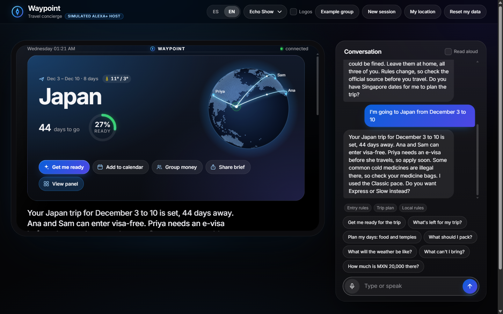
</p>

**Hackathon:** [Amazon Developer — Build, Ship, Shape 2026](https://amazonappdev2026.devpost.com/) · **Primary track:** Alexa+ · **Mini challenges:** AWS Builder · Open Source

**Not affiliated with Amazon.** Waypoint is a *simulated* Alexa+ host: Alexa+ partner tooling is not public, so the MCP server is self-hosted and the browser is a real MCP client (the path the FAQ allows).

---

## For judges — open it on your phone

<table>
<tr>
<td width="56%" valign="top">

**Live demo (no install):**
**[Open Waypoint →](https://hwbs7pqoqtsbcgb72stpikb5gy0scxmv.lambda-url.us-east-1.on.aws/)**

| Step | Do this |
|:---:|---------|
| 1 | Open the link (Safari / Chrome on a phone is fine) |
| 2 | Switch language to **EN** (under **Settings** on a phone) |
| 3 | Say who is travelling: type *"We are three travelers: Ana has a Mexican passport, Sam has a US passport and Priya has an Indian passport."* — or tap **Example group** for the same three |
| 4 | Ask *"Can I bring vapes to Singapore?"* |
| 5 | Ask *"I'm going to Japan from December 3 to 10"* |
| 6 | Tap **Get me ready** — Autopilot runs 9 live tool calls |

That is the whole product demo. No clone, no AWS console, no keys in the browser. Apart from step 3 (where **Example group** is the no-typing shortcut), every step is a tappable suggestion chip.

</td>
<td width="44%" valign="top" align="center">
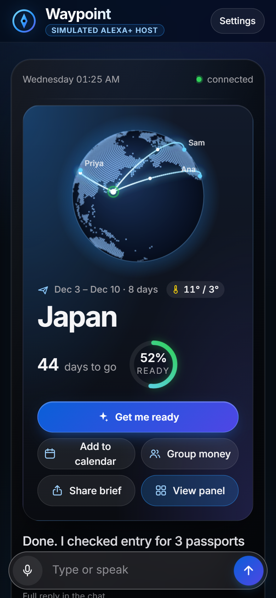
</td>
</tr>
</table>

### Fast links

| What | Link |
|------|------|
| **Live demo** | [Open Waypoint](https://hwbs7pqoqtsbcgb72stpikb5gy0scxmv.lambda-url.us-east-1.on.aws/) |
| **Health** | [GET /healthz](https://hwbs7pqoqtsbcgb72stpikb5gy0scxmv.lambda-url.us-east-1.on.aws/healthz) → `protocolVersion: "2025-11-25"` |
| **LLM brief** | [/llms.txt](https://hwbs7pqoqtsbcgb72stpikb5gy0scxmv.lambda-url.us-east-1.on.aws/llms.txt) · repo: [llms.txt](llms.txt) · [llm.txt](llm.txt) |
| **Agent playbook** | [AGENTS.md](AGENTS.md) |
| **Docs index** | [docs/README.md](docs/README.md) |
| **Friction log** | [24 entries](docs/FRICTION_LOG.md) — Alexa Skills Kit, ASK CLI, Lambda, IAM OIDC, Bedrock + Strands — each with steps, severity, workaround, suggestion, and the fixing commit |
| **Video / feedback / checklist** | [DEMO_SCRIPT](docs/DEMO_SCRIPT.md) · [FEEDBACK](docs/FEEDBACK.md) · [SUBMISSION](docs/SUBMISSION.md) |

---

## Why this beats a chatbot: one trip, three passports

Ana, Sam and Priya are going to Japan together. Whether you need a visa depends on **your passport, not the trip**: Ana holds a Mexican passport, Sam a US one, Priya an Indian one. That makes the same question have three different correct answers. A chatbot without tools answers "you" in one paragraph, from memory, and forgets the group in the next session. Waypoint answers per traveler, from data, with a source, and remembers the group.

### Step 1 · Say who is travelling, in plain words

> *"We are three travelers: Ana has a Mexican passport, Sam has a US passport and Priya has an Indian passport."*

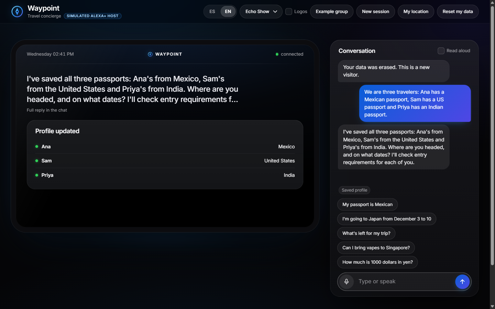

There is no form. The Bedrock agent turns the sentence into one structured tool call, copied from the live protocol log:

```json
tools/call update_traveler_profile
{ "travelers": [
    { "displayName": "Ana",   "passports": ["MX"] },
    { "displayName": "Sam",   "passports": ["US"] },
    { "displayName": "Priya", "passports": ["IN"] } ] }
```

Only the **country** of each passport is stored, never a passport number. If a nationality is missing, Waypoint asks for it (MCP elicitation) instead of guessing.

### Step 2 · Ask once, get three answers

> *"We're going to Japan from December 3 to 10. Do we need visas?"*

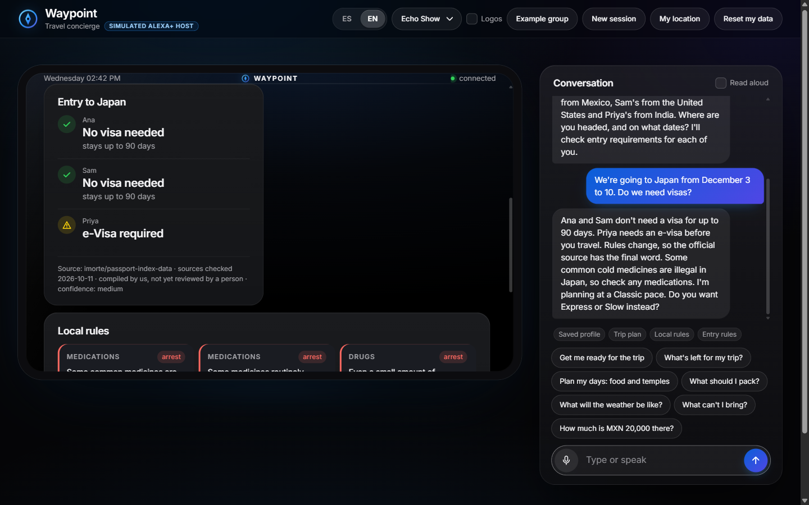

> **Waypoint:** *"Ana and Sam don't need a visa for up to 90 days. Priya needs an e-visa before you travel. Rules change, so the official source has the final word."*

Behind that one sentence, the agent made these calls on the server (from the same log):

```text
⇄ tools/call get_traveler_profile
⇄ tools/call plan_trip                 { destination: "JP", startDate: "2026-12-03", endDate: "2026-12-10", travelerIds: [Ana, Sam, Priya] }
⇄ tools/call check_entry_requirements  { destination: "JP", purpose: "tourism", travelerIds: [Ana, Sam, Priya] }
⇄ tools/call get_local_rules           { destination: "JP" }
```

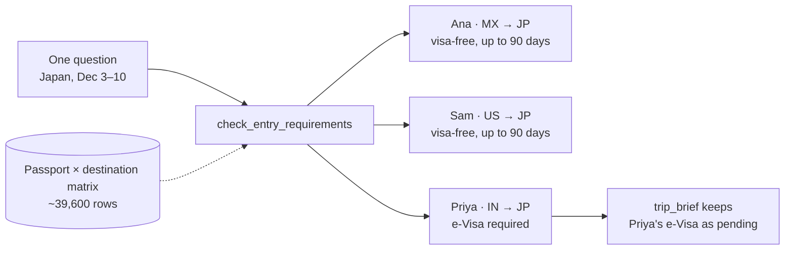

### The difference, row by row

| | Chatbot without tools | Waypoint |
|---|---|---|
| **Who the answer is for** | "You", one answer for the group unless you ask three times | One row per traveler: Ana and Sam visa-free (up to 90 days), Priya e-Visa required |
| **Where the fact comes from** | Training data, which may be out of date, with no date | A passport × destination matrix (~39,600 rows); the card shows the source, the date it was checked, and the confidence |
| **Next session** | The group is gone; you type it again | Saved: every later question (rules, packing, Autopilot) already knows all three passports |
| **What happens next** | A paragraph of text | A saved trip; `trip_brief` lists *"check the entry requirement for Priya (e-Visa required)"* as pending, and readiness stays below 100% until it's done |
| **When the data is missing** | May guess | Says there is no verified data and points to the official source |
| **Proof** | None | Every call appears in the MCP protocol log |

Try it yourself: steps 3 and 5 of [For judges](#for-judges--open-it-on-your-phone) are exactly this flow.

---

## Contents

1. [Why this beats a chatbot](#why-this-beats-a-chatbot-one-trip-three-passports)
1. [Demo walkthrough](#demo-walkthrough)
2. [How one question becomes a cited answer](#how-one-question-becomes-a-cited-answer)
3. [Knowledge scale](#knowledge-scale--what-we-actually-built)
4. [MCP tools (26) — full catalog](#mcp-tools-26--full-catalog)
5. [Autopilot](#autopilot--one-sentence-full-prep)
6. [Architecture](#architecture)
7. [Why this fits Alexa+](#why-this-fits-alexa)
8. [AWS Builder](#aws-builder)
9. [Security model](#security-model)
10. [Open Source](#open-source) · [Data honesty](#data-honesty--limits) · [Run locally](#run-locally) · [Repository map](#repository-map)

---

## Demo walkthrough

All screenshots are from the **live public deployment**, in English, with the Example group loaded.

### 1 · Home — a simulated Echo Show with a real MCP connection

The green **connected** dot means the browser finished the MCP `initialize` handshake with the server. Suggestion chips cover the main flows.

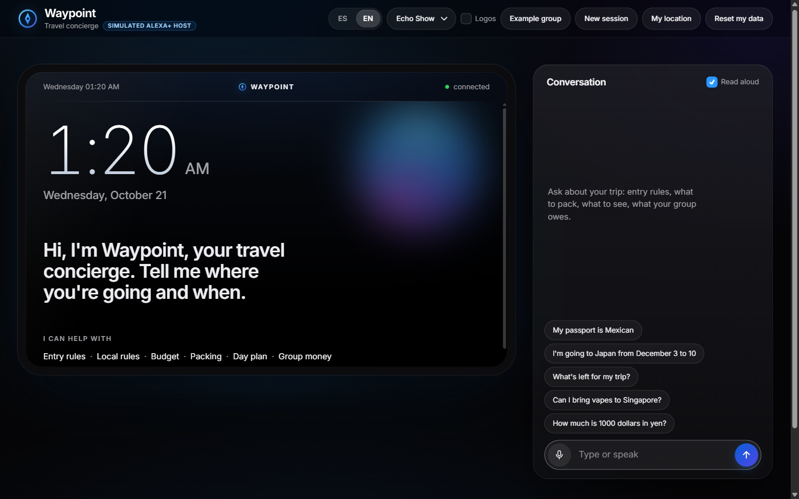

### 2 · Local rules — a direct answer, the source, and the date

*"Can I bring vapes to Singapore?"* is answered from a quote-checked country pack. The card shows the severity (`fine`), the source (FCDO travel advice), when it was checked, and the confidence level.

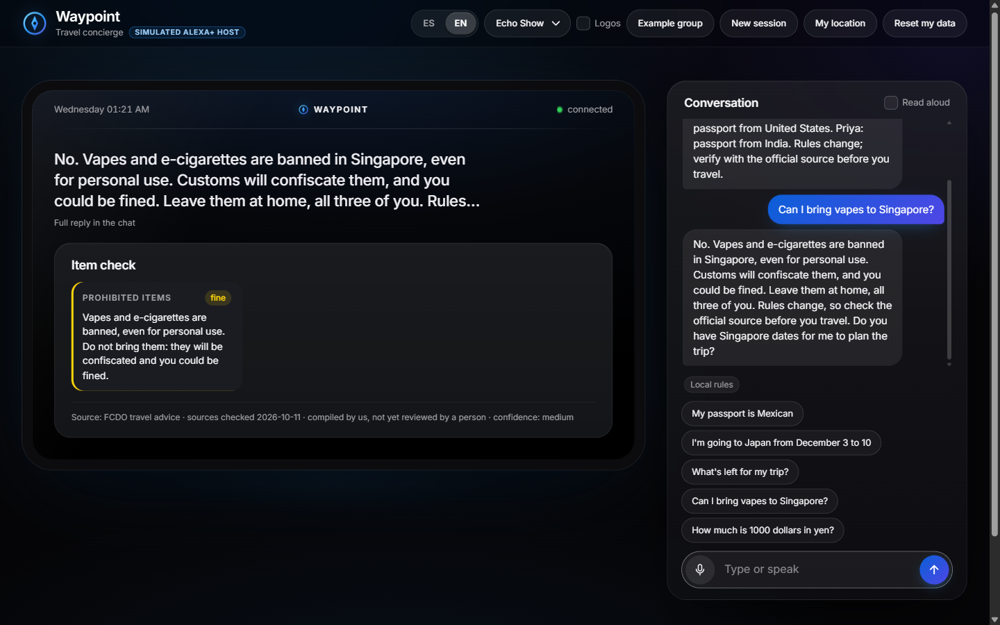

### 3 · Trip planned — entry checked for each passport

*"I'm going to Japan from December 3 to 10"* creates the trip and checks entry for every traveler: Ana and Sam can enter visa-free, Priya needs an e-Visa (the full story is in [one trip, three passports](#why-this-beats-a-chatbot-one-trip-three-passports)). Below that, Japan's serious rules (medicines, knives, meat) appear with severity labels.


### 4 · Autopilot — one tap, nine live tool calls

**Get me ready** runs a visible graph of real `tools/call`s. Each row shows the tool name, its sources, and how long it took. Readiness rises from 27% to 52%, and the remaining gap (Priya's paperwork) is named.

<table>
<tr>
<td width="66%">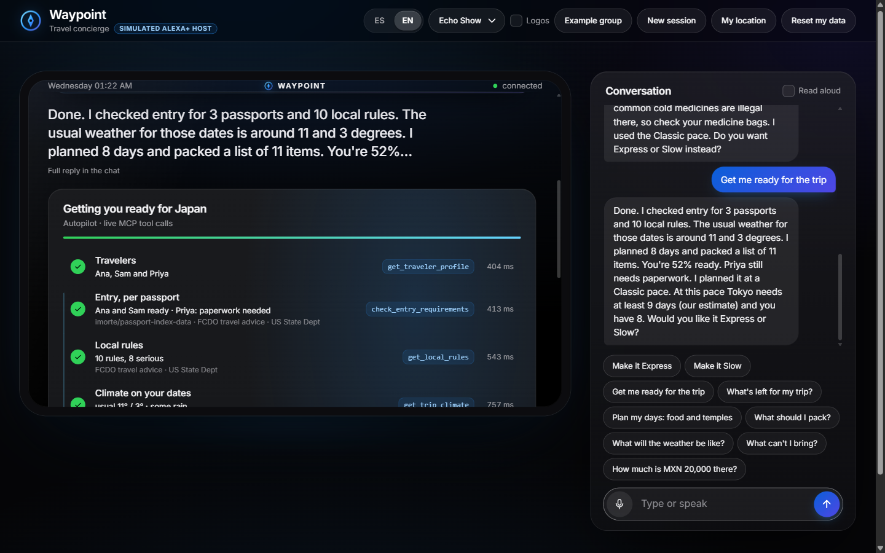</td>
<td width="34%">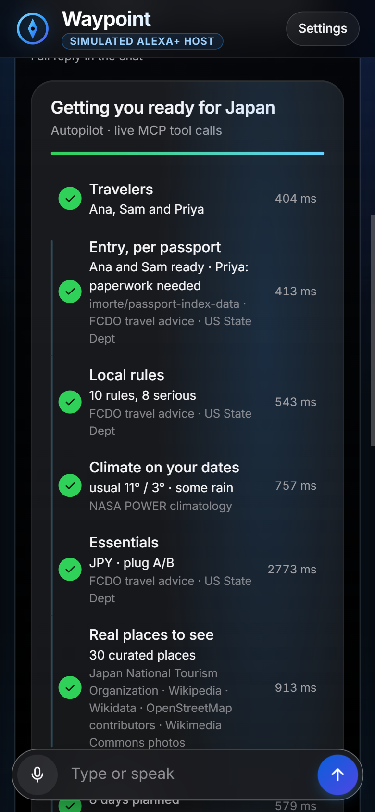</td>
</tr>
</table>

### 5 · MCP App — the trip dashboard

**View panel** opens the `plan_trip` MCP App resource (`ui://waypoint/plan-dashboard-*.html`) in a sandboxed iframe: entry per traveler, essentials (currency, plugs, emergency numbers, language), and rules.

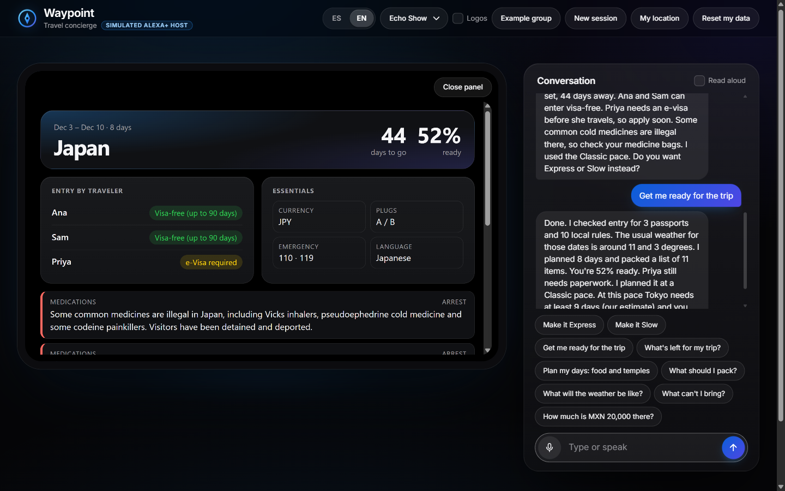

### 6 · Proof — the MCP protocol log

At the bottom of the page, **For developers: MCP protocol log** shows every JSON-RPC message the browser sent and received: `initialize`, `tools/list`, and each `tools/call` with its structured envelope.

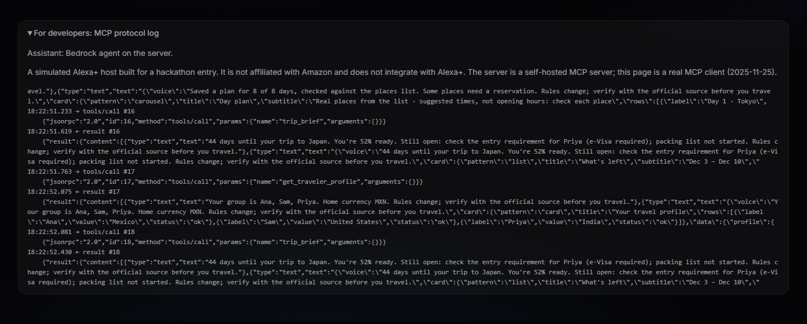

---

## How one question becomes a cited answer

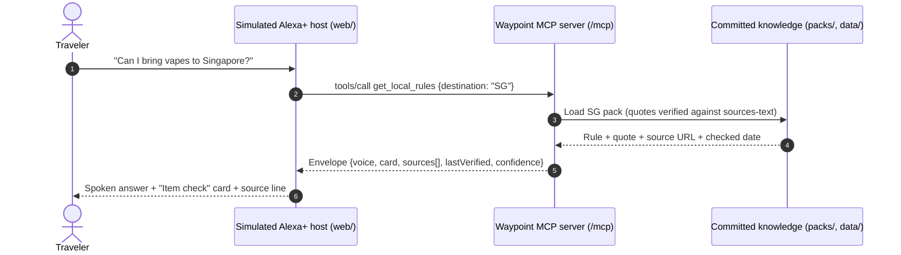

The host can route a question with its local router or hand it to the optional **Bedrock + Strands** brain on the server. Either way, the facts come from tool calls. The model never writes visa rules itself.

---

## Knowledge scale — what we actually built

This is not a thin wrapper around one API. Every answer is backed by **committed, cited catalogs** under `data/` and `packs/`.

| Dataset | Scale | What it powers |
|--------|------:|----------------|
| Passport → destination matrix | **~39,600** passport × destination rows | `check_entry_requirements`, `plan_trip` |
| Country entry-rule packs | **13** destinations, quotes checked against source text | `get_local_rules`, `plan_trip` |
| Official source text cache | **13** countries | Pack validation (`validate-packs`) |
| Curated places | **194** countries · **~14,100** places | `get_highlights`, `build_itinerary` |
| Ranked place lists (fallback) | **182** countries | `get_highlights` when no curated list |
| Travel guide topics | **72** countries | `get_travel_guide` |
| Payment methods | **197** countries | `get_payment_methods` |
| "What works without my card" | **195** countries | `get_what_works` |
| Country-level transit notes | **174** countries | `get_transit_payment` |
| Named metro / city systems | **13** (London, NYC, Tokyo, Singapore, …) | Tap-to-pay + local cards (Oyster, Suica, …) |
| Travel apps by country | Company lists + press (Uber, Grab, DiDi, …) | `get_local_apps` |
| Countries / cities gazetteer | **197** countries · **1,698** cities | Name resolution EN/ES, near-me |
| Climate normals | Capitals via NASA POWER | `get_trip_climate`, packing |
| Plugs & emergency numbers | Wikidata, worldwide | `get_destination_essentials` |
| FX + PPP | Live FX or offline snapshot + World Bank PPP | `convert_budget` |

### How a rule earns its place in a pack

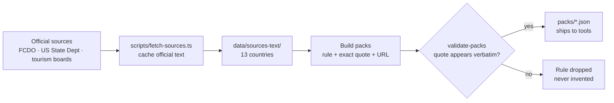

Every tool result carries `sources[]`, `lastVerified`, `confidence`, and a disclaimer.

---

## MCP tools (26) — full catalog

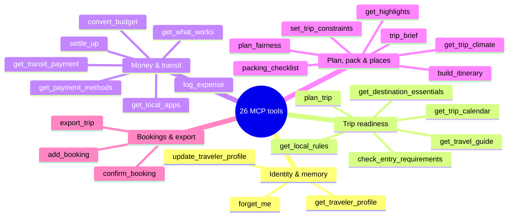

Every tool declares `inputSchema`, `outputSchema`, and annotations (`readOnlyHint`, `destructiveHint`, `idempotentHint`, `openWorldHint`), and returns the same envelope:

```text
{ voice, card, data, sources[], lastVerified, confidence, disclaimer, followUps[], missingFields? }
```

Errors are traveler-friendly: no stack traces, raw URLs, HTTP codes, or tool names in `voice`. Schemas live in [`src/tools.ts`](src/tools.ts).

### Identity & memory

| Tool | What the traveler asks | What the agent uses / returns |
|------|------------------------|-------------------------------|
| `get_traveler_profile` | What do you know about us? | Saved travelers, home currency, preferences; sensitive fields only with consent |
| `update_traveler_profile` | Save me / my companions | Passports (country, not number), age band, likes / avoids; elicits a missing passport |
| `forget_me` | Delete my data | Confirmed wipe of profile, trips, and expenses for this visitor |

### Trip readiness (hero)

| Tool | What the traveler asks | Knowledge behind it |
|------|------------------------|---------------------|
| `plan_trip` | Going to Japan Dec 3–10 | Creates the trip; entry per passport; top rules; essentials; days left; opens the **MCP App** dashboard |
| `check_entry_requirements` | Do we need a visa? | Passport matrix (~39.6k rows); one row per traveler |
| `get_local_rules` | What can't I bring or do? | Quote-checked packs (`packs/` + `data/sources-text/`); severity + source |
| `get_destination_essentials` | Plugs, emergency numbers, currency | Wikidata plugs/emergency + country currency |
| `get_travel_guide` | Practical country how-to | Guide topics for **72** countries (entry, safety, money, etiquette, …) with sources |
| `get_trip_calendar` | Holidays / sun / best months | Holidays + sun/forecast APIs + climate normals, labelled by source |

### Money, payments & getting around

| Tool | What the traveler asks | Knowledge behind it |
|------|------------------------|---------------------|
| `convert_budget` | How far does my money go? | Live FX or offline snapshot + World Bank PPP |
| `get_payment_methods` | How do I pay there? | **197** countries: cash, cards, QR/wallets, ATMs; official vs guide-labelled |
| `get_what_works` | My card failed — what else? | **195** countries: visitor-usable options; **never** invents crypto acceptance |
| `get_local_apps` | Does Uber / Grab / … work? | Per-country app availability (company lists + press, labelled) |
| `get_transit_payment` | Can I tap my bank card on the metro? | **13** city systems + **174** country notes; local cards (Oyster, Suica, …) |
| `log_expense` | I spent X | Group expense with payer / split; spending-limit warning |
| `settle_up` | Who owes whom? | Exact balances + fewest transfers |

### Plan, pack & places

| Tool | What the traveler asks | Knowledge behind it |
|------|------------------------|---------------------|
| `get_trip_climate` | What's the weather like? | NASA POWER normals for the trip dates (usual weather, not a forecast) |
| `packing_checklist` | What do I pack? | Length + climate + plugs + kids/meds + "do not pack" rules; ticks persist |
| `get_highlights` | What's worth seeing / near me? | **~14.1k** curated places across **194** countries (+ ranked fallback for **182**) |
| `set_trip_constraints` | Avoid nightlife; under $1000 | Constraints every plan and expense respects |
| `build_itinerary` | Day plan | Stops must be catalog place ids; the **verifier** rejects bad pace / country / avoided interests |
| `trip_brief` | What's left for my trip? | Readiness, pending items, free-cancellation deadlines |
| `plan_fairness` | Is the plan fair to everyone? | Share of liked / avoided stops per traveler |

### Bookings & export

| Tool | What the traveler asks | Knowledge behind it |
|------|------------------------|---------------------|
| `add_booking` | I booked a flight / hotel | Stores the confirmation; pending until confirmed |
| `confirm_booking` | Confirm that booking | Marks the booking confirmed |
| `export_trip` | Put it in my calendar | ICS calendar or Markdown export |

---

## Autopilot — one sentence, full prep

Say *"Get me ready for the trip"* or tap **Get me ready** on a saved trip. The host runs this graph of real MCP calls (`web/mission.js`):

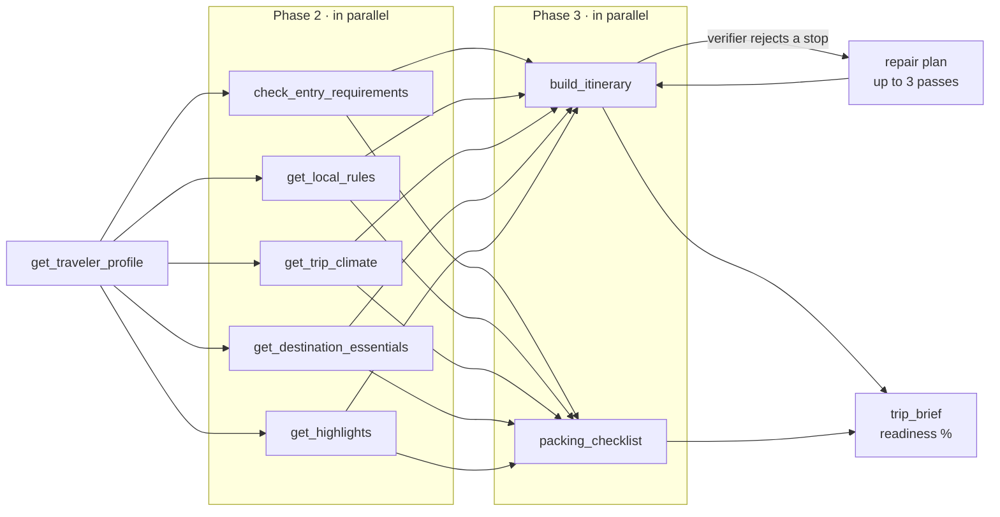

On the live demo this is **9 MCP calls, 5 in parallel, about 4 seconds**. The server verifies every day plan before saving it. When the verifier rejects a stop (wrong country, too many stops for the pace, an interest the group avoids), the host drops that stop and sends the plan again. At the end, every source used is listed. Tests: `test/web-mission.test.ts`.

---

## Architecture

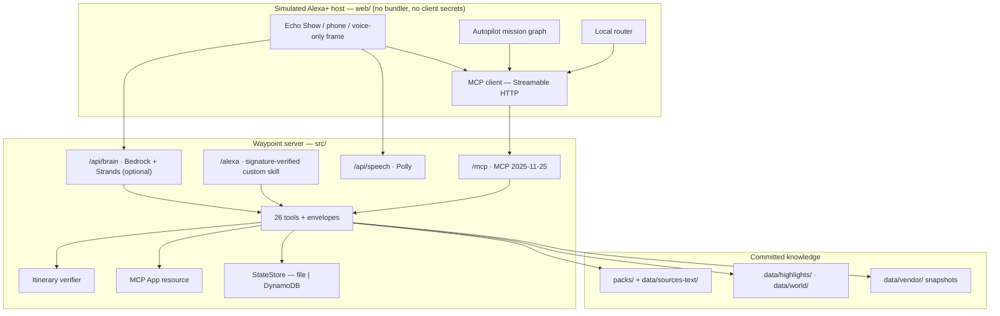

| Layer | Owns | Never does |
|-------|------|------------|
| `web/` | UX, MCP client, Autopilot orchestration UI | Invent visa or rules facts |
| `src/tools.ts` | Facts via services + packs; envelopes | Trust raw LLM prose as law |
| `src/itinerary.ts` | Accept / reject day plans by rules | Soften limits because a model asked |
| `src/brain.ts` | Multi-tool turns when enabled | Bypass tools for entry or rules |

---

## Why this fits Alexa+

| Alexa+ creative signal | How Waypoint does it | See it in the demo |
|---|---|---|
| Agentic workflows across services | Autopilot + optional Bedrock/Strands multi-tool turns | Walkthrough step 4 |
| State across sessions | Profile, trips, expenses keyed by visitor / Alexa user | Reload the page: the trip is still there |
| Cards / multi-modal | Envelope cards, carousels, Echo Show frame, Polly voice | Walkthrough steps 2–3 |
| MCP Apps | Plan dashboard as a `ui://waypoint/...` resource | Walkthrough step 5 |
| Elicitation | Asks for a missing passport country; confirms `forget_me` | **Reset my data** |
| Honest simulation path | Full `web/` source; FAQ-allowed MCP client in the browser | Walkthrough step 6 |

`agent-skills/waypoint/SKILL.md` is a **Claude/operator skill file**, not an Alexa Agent Skill.

---

## AWS Builder

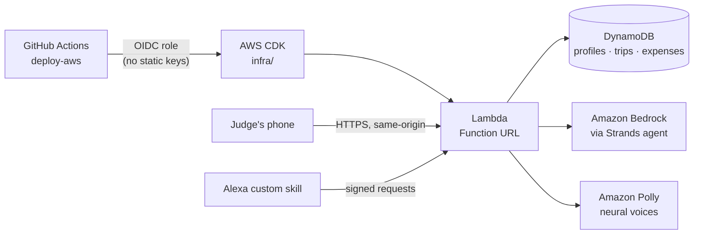

| Piece | AWS service | Status |
|---|---|---|
| Concierge brain | **Bedrock** via **Strands** (`src/brain.ts`) | Live (`/healthz` reports `brain: true`); smoke via `aws-smoke` workflow |
| Hosting | **Lambda** Function URL + **DynamoDB** state | CDK + `deploy-aws` workflow |
| Voice (simulator) | **Polly** neural voices | Used by `web/` when **Read aloud** is on |
| CI | OIDC → AWS (no static deploy keys in git) | `deploy-aws.yml`, `deploy-skill.yml` |

Detail and cost notes: [docs/AWS.md](docs/AWS.md). Product feedback: [docs/FEEDBACK.md](docs/FEEDBACK.md).

---

## Security model

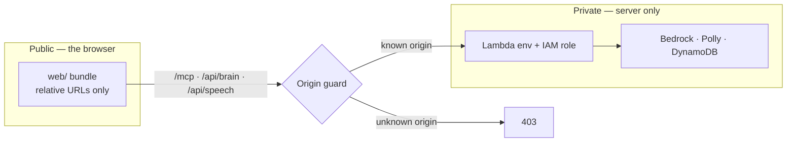

| Control | Behavior |
|---|---|
| **No client secrets** | The UI only calls same-origin `/mcp` and `/api/*`. No `NEXT_PUBLIC_*`, `EXPO_PUBLIC_*`, `VITE_*`, or bundled AWS/Alexa secrets |
| **Origin guard** | Unknown browser origins get `403` on `/mcp` |
| **No passport numbers** | Only the country (+ optional expiry). Medications need consent and are never sent to third-party APIs |
| **Elicitation** | Missing passport / `forget_me` confirmation via MCP elicitation (or `missingFields`) |
| **MCP App sandbox** | Dashboard iframe: no `localStorage`, no parent access |
| **Alexa `/alexa`** | Amazon request signature verified; unsigned requests rejected |
| **Secrets** | GitHub Actions secrets + OIDC roles. No static AWS keys or Alexa refresh tokens in git |
| **Demo identity** | `x-waypoint-user` header — a convenience for the simulator, **not** OAuth 2.1/PKCE |

**Abuse notes (honest):** anyone who can reach the public `/mcp` and set a user id can read that id's demo state, so the public URL is demo-grade and holds synthetic profiles only. See [AGENTS.md](AGENTS.md) § Security review.

---

## Open Source

| Package | Location | Licence |
|---|---|---|
| **travel-entry-packs** — schema, validator, sample JP/SG packs | [`oss/travel-entry-packs/`](oss/travel-entry-packs/) | MIT |

Publish steps and Devpost fields: [docs/OPEN_SOURCE.md](docs/OPEN_SOURCE.md). This repo is **MIT** too ([`LICENSE`](LICENSE)).

---

## Data honesty / limits

> Rules change. Verify with the official source before you travel. Packs are **tier B (machine-extracted)** until a human signs off ([docs/DATA_REVIEW.md](docs/DATA_REVIEW.md)). The cards say so: *"compiled by us, not yet reviewed by a person"*.

| Limit | What we do instead of inventing |
|---|---|
| Visa matrix snapshot (2026-02-17) | Labelled; not a live government feed |
| Opening hours / prices | Not claimed; map links + disclaimer |
| Event finder | Not implemented (no verified source) |
| Highlights ranking | Wikipedia popularity can be noisy; curated lists win first |
| Crypto payments | Never listed as accepted |

Major upstreams: passport-index (MIT), GOV.UK FCDO (OGL v3), US State Dept (public domain), Wikidata (CC0), World Bank PPP (CC BY 4.0), NASA POWER, open.er-api (attribution), Wikipedia sentences (CC BY-SA 4.0). Vendored licences sit next to the data under `data/vendor/`.

---

## Run locally

Optional — the live demo covers everything. Requires Node.js **≥ 22**.

```bash
git clone https://github.com/altaga/Waypoint.git
cd Waypoint
npm install
npm start                    # http://127.0.0.1:3000 and /mcp
WAYPOINT_OFFLINE=1 npm start # no network calls
```

| Goal | Command |
|---|---|
| Full CI gate (typecheck + tests + packs + eval) | `npm run ci` |
| Validate packs | `npm run validate-packs` |
| Accuracy eval | `npm run eval` |
| Bedrock brain | `WAYPOINT_BRAIN=bedrock` + `WAYPOINT_BEDROCK_MODEL` (see `.env.example`) |

Copy `.env.example` to `.env` for local settings; **never commit `.env`**. Deploy, Alexa skill, and live smoke: [docs/AWS.md](docs/AWS.md), [docs/TESTING.md](docs/TESTING.md).

---

## Repository map

```
Waypoint/
├── src/            MCP server, 26 tools, verifier, brain, Alexa bridge
├── web/            Simulated Alexa+ host (same-origin /mcp)
├── packs/          Country entry-rule packs (quote-checked)
├── data/           All catalogs — see data/README.md
│   ├── highlights/ Curated places (preferred)
│   ├── world/      Payments, transit, apps, cities, ranked highlights
│   ├── sources-text/ Cached official text for pack validation
│   └── vendor/     Vendored public snapshots + licences
├── skill/          Alexa custom skill (manifest + EN/ES models)
├── agent-skills/   Claude/operator skill file (not an Alexa Agent Skill)
├── oss/            Open-source travel-entry-packs package
├── infra/          AWS CDK stack
├── ops/            Owner-only helpers (credentials, secret-box, demo recorder)
├── scripts/        Data build + live smoke
├── test/           Offline unit + e2e + eval
├── docs/           Judge/Devpost docs — docs/README.md
├── llms.txt        LLM brief (also served at /llms.txt)
└── AGENTS.md       Full agent playbook
```

---

## Licence

MIT — see [`LICENSE`](LICENSE).
