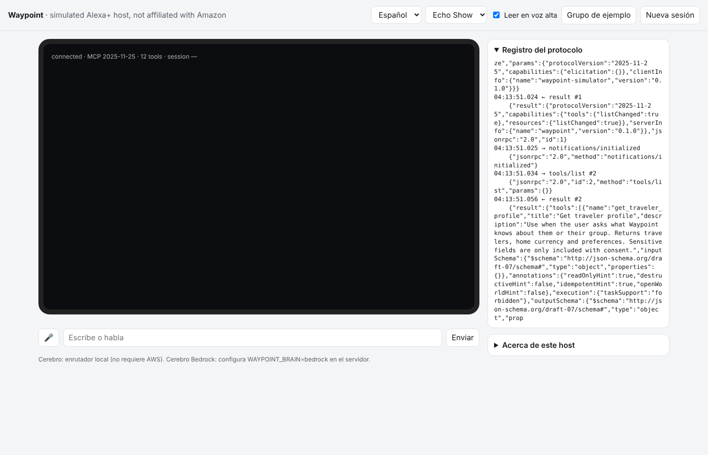
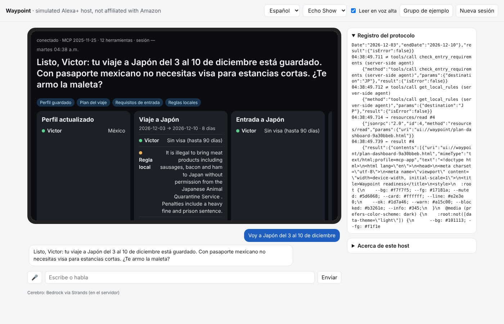
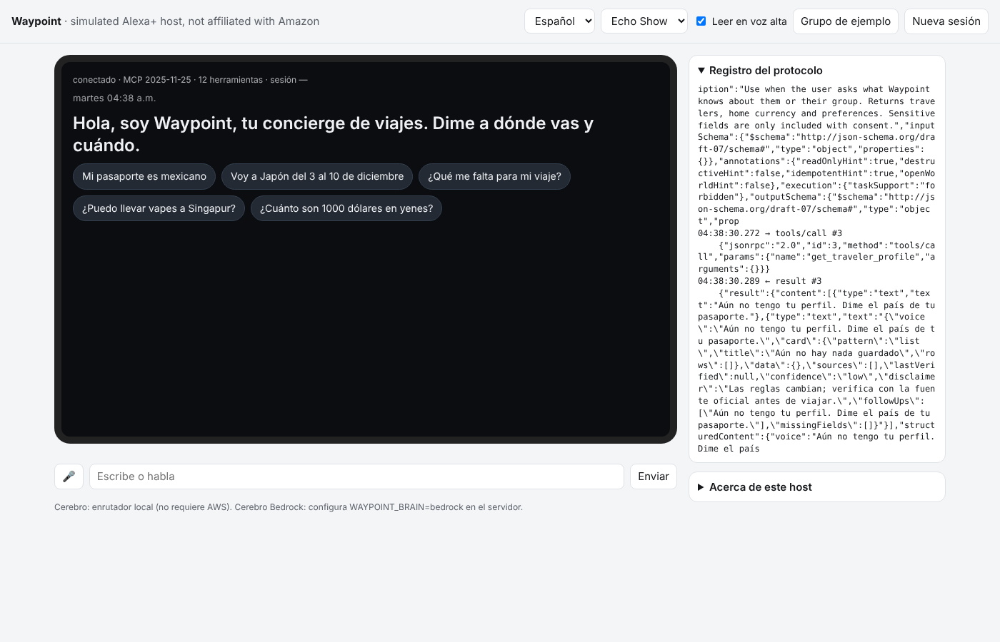
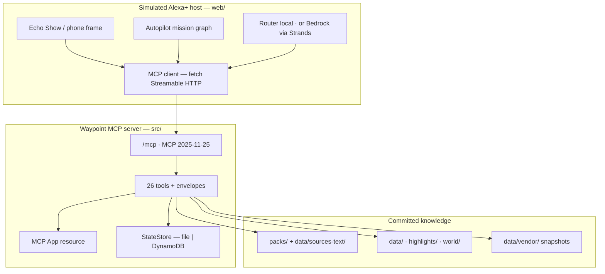

# Waypoint — Travel-readiness concierge for Alexa+

> **Tell Waypoint who is travelling and where.** It answers with cited official sources, dated and confidence-flagged: can each traveler enter, what to arrange in advance, what not to bring or do, what it costs, what to pack, and what the day plan looks like. It remembers the trip between sessions.

**Hackathon:** [Amazon Developer — Build, Ship, Shape 2026](https://amazonappdev2026.devpost.com/) · **Primary track:** Alexa+ · **Mini challenges:** AWS Builder · Open Source

**Not affiliated with Amazon.** Waypoint is a *simulated* Alexa+ host: Alexa+ partner tooling is not public, so the MCP server is self-hosted and the browser is a real MCP client (the path the FAQ allows).

---

## For judges — open it on your phone

**Live demo (no install):**  
**[https://hwbs7pqoqtsbcgb72stpikb5gy0scxmv.lambda-url.us-east-1.on.aws/](https://hwbs7pqoqtsbcgb72stpikb5gy0scxmv.lambda-url.us-east-1.on.aws/)**

Works on a phone browser. Narrow screens open in the **phone** layout automatically.

| Step | Do this |
|------|---------|
| 1 | Open the link above (Safari / Chrome on your phone is fine) |
| 2 | Switch language to **EN** (top controls; use ☰ on a small screen if collapsed) |
| 3 | Tap **Example group** |
| 4 | Ask: *"Can I bring vapes to Singapore?"* |
| 5 | Ask: *"Going to Japan 3–10 December"* — cards + sources |
| 6 | Optional: *"Get me ready for the trip"* — Autopilot (multi-tool run) |

That is the whole product demo. No clone, no AWS console, no API keys in the browser.

### Fast links

| What | Link |
|------|------|
| **🚀 Live demo** | [Open Waypoint](https://hwbs7pqoqtsbcgb72stpikb5gy0scxmv.lambda-url.us-east-1.on.aws/) |
| **Health** | [GET /healthz](https://hwbs7pqoqtsbcgb72stpikb5gy0scxmv.lambda-url.us-east-1.on.aws/healthz) → `protocolVersion: "2025-11-25"` |
| **LLM brief** (after next deploy of this tree) | [/llms.txt](https://hwbs7pqoqtsbcgb72stpikb5gy0scxmv.lambda-url.us-east-1.on.aws/llms.txt) · repo: [llms.txt](llms.txt) · [llm.txt](llm.txt) |
| **Agent playbook** | [AGENTS.md](AGENTS.md) |
| **Docs index** | [docs/README.md](docs/README.md) |
| **Video / feedback / friction / checklist** | [DEMO_SCRIPT](docs/DEMO_SCRIPT.md) · [FEEDBACK](docs/FEEDBACK.md) · [FRICTION_LOG](docs/FRICTION_LOG.md) · [SUBMISSION](docs/SUBMISSION.md) |

### What the main buttons do

| Control | What it does |
|---------|----------------|
| **Example group** | Loads three demo travelers (MX / US / IN) so entry tools have passports |
| **ES / EN** | UI + spoken language |
| **Echo Show / Mobile / Voice** | Frame only — same backend; phones default to Mobile |
| **Logos** | Brand marks — leave **off** for the contest video |
| **New session** | Reconnects MCP; keeps this visitor’s trip |
| **Reset / Borrar mis datos** | Wipes this visitor (two taps) |
| **Protocol log** | Proof of real MCP calls (easier on a wide screen; optional on phone) |

### Public demo security (no client secrets)

The page only talks to **same-origin** paths: `/mcp`, `/api/brain`, `/api/speech`, `/healthz`.  
Bedrock, Polly, DynamoDB and Alexa credentials live on the **server** (Lambda env / GitHub Actions OIDC).  
**Never** ship `NEXT_PUBLIC_*`, `EXPO_PUBLIC_*`, `VITE_*`, or any bundled env with keys or private URLs.

### Optional: run locally

```bash
npm install && npm start   # Node ≥ 22 → http://127.0.0.1:3000
WAYPOINT_OFFLINE=1 npm start
```

---

## Knowledge scale — what we actually built

This is not a thin wrapper around one API. Every answer is backed by **committed, cited catalogs** under `data/` and `packs/`. Snapshot of the inventory (counts from this repo):

| Dataset | Scale | What it powers |
|--------|------:|----------------|
| Passport → destination matrix | **~39,600** passport×destination rows | `check_entry_requirements`, `plan_trip` |
| Country entry-rule packs | **13** destinations, quotes checked against source text | `get_local_rules`, `plan_trip` |
| Official source text cache | **13** countries | Pack validation (`validate-packs`) |
| Curated places | **194** countries · **~14,100** places | `get_highlights`, `build_itinerary` |
| Ranked place lists (fallback) | **182** countries | `get_highlights` when no curated pack |
| Travel guide topics | **72** countries | `get_travel_guide` |
| Payment methods | **197** countries | `get_payment_methods` |
| “What works without my card” | **195** countries | `get_what_works` |
| Country-level transit notes | **174** countries | `get_transit_payment` |
| Named metro / city systems | **13** (London, NYC, Tokyo, Singapore, …) | Tap-to-pay + local cards (Oyster, Suica, …) |
| Travel apps by country | Company lists + press (Uber, Grab, DiDi, …) | `get_local_apps` |
| Countries / cities gazetteer | **197** countries · **1,698** cities | Name resolution EN/ES, near-me |
| Climate normals | Capitals via NASA POWER | `get_trip_climate`, packing |
| Plugs & emergency numbers | Wikidata worldwide | `get_destination_essentials` |
| FX + PPP | Live FX or offline snapshot + World Bank PPP | `convert_budget` |

Every tool result carries `sources[]`, `lastVerified`, `confidence`, and a disclaimer. Packs **refuse to invent**: a rule ships only if its quote appears verbatim in `data/sources-text/`.

→ Full tool-by-tool table: [MCP tools (26) — full catalog](#mcp-tools-26--full-catalog)

---

## Contents

1. [For judges — open it on your phone](#for-judges--open-it-on-your-phone)
2. [Knowledge scale](#knowledge-scale--what-we-actually-built)
3. [MCP tools (26) — full catalog](#mcp-tools-26--full-catalog)
4. [30 seconds](#30-seconds)
5. [At a glance](#at-a-glance)
6. [Demo — what judges see](#demo--what-judges-see)
7. [Why this fits Alexa+](#why-this-fits-alexa)
8. [Architecture](#architecture)
9. [Autopilot](#autopilot-one-sentence-full-prep)
10. [How to reproduce](#how-to-reproduce)
11. [AWS Builder](#aws-builder)
12. [Open Source](#open-source)
13. [Security model](#security-model)
14. [Data honesty](#data-honesty--limits)
15. [Repository map](#repository-map)

---

## 30 seconds

Travel advice online is scattered, undated, and easy to invent. Waypoint refuses to invent: every entry rule, local prohibition, plug type, transit card, and payment fact carries a **source, a date, and a confidence flag**. Identity is a browser visitor id (no account). The host speaks, shows cards, elicits missing passport countries, and opens an **MCP App** dashboard for the trip.

```
Traveler asks (voice or text)
        │
        ▼
Simulated Alexa+ host (web/)  ← real MCP client, Streamable HTTP
        │
        ▼
Waypoint MCP server (src/)    ← 26 tools · envelopes · elicitation · MCP App
        │
        ├── Offline packs + vendor snapshots (committed)
        ├── Optional Bedrock brain via Strands (AWS Builder)
        └── State: file locally · DynamoDB on Lambda
```

After this README you should be able to say: *"Waypoint is a self-hosted MCP 2025-11-25 travel concierge with a simulated Alexa+ host that actually calls tools — not a chatbot wrapping one API."*

---

## At a glance

| | Fact | Proof in this repo |
|---|---|---|
| **Alexa+ required tech** | MCP **2025-11-25** over **Streamable HTTP** | `src/mcp-server.ts`, `src/server.ts`, `/healthz` |
| **Real MCP client** | Browser host: `initialize` · `tools/list` · `tools/call` | `web/mcp-client.js` + protocol log in UI |
| **Agentic, not Q&A** | Autopilot runs a visible graph of real tool calls | `web/mission.js`, `test/web-mission.test.ts` |
| **MCP Apps** | `plan_trip` opens a sandboxed dashboard iframe | `src/resources.ts`, `_meta.ui.resourceUri` |
| **Cited answers** | Packs only keep rules whose quote appears in source text | `npm run validate-packs`, `packs/*.json` |
| **Knowledge depth** | ~39.6k visa rows · 14k+ places · 197 payment countries · 26 tools | [Knowledge scale](#knowledge-scale--what-we-actually-built) |
| **AWS Builder** | Bedrock + Strands brain; Lambda + DynamoDB hosting | `src/brain.ts`, `docs/AWS.md`, `.github/workflows/` |
| **Open Source** | MIT schema + validator + sample packs | `oss/travel-entry-packs/` |
| **Offline CI** | Typecheck, unit + e2e, pack validation, golden eval | `npm run ci` |

---

## Demo — what judges see

| Simulator connected | Trip planned with sources | Concierge + protocol log |
|---|---|---|
|  |  |  |

The right-hand **protocol log** is the proof surface: every `tools/call` is visible. Screenshots may show an older tool count; the server currently exposes **26** tools (see below).

Same flow as [For judges — 5 minutes](#for-judges--5-minutes). Full narration: [docs/DEMO_SCRIPT.md](docs/DEMO_SCRIPT.md). Optional Bedrock brain: `WAYPOINT_BRAIN=bedrock`.

---

## Why this fits Alexa+

Judges look for more than a single-turn FAQ bot. Waypoint ships:

| Alexa+ creative signal (rules) | How Waypoint does it |
|---|---|
| Agentic workflows across services | Autopilot + optional Bedrock/Strands multi-tool turns |
| State across sessions | Profile, trips, expenses keyed by visitor / Alexa user |
| Cards / multi-modal | Envelope cards, carousels, Echo Show frame, Polly voice |
| MCP Apps | Plan dashboard as `ui://waypoint/...` resource |
| Honest simulation path | Full `web/` source; FAQ-allowed MCP client in-browser |

`agent-skills/waypoint/SKILL.md` is a **Claude/agent skill file** for operators — **not** an Alexa Agent Skill. Do not present it as one.

---

## Architecture



**Invariant:** answers come from tools and committed data. The optional LLM brain **calls tools**; it does not invent visa rules.

---

## Autopilot: one sentence, full prep

Say *"Get me ready for Japan from December 3 to 10"* (or tap **Get me ready** on a saved trip). The host:

1. Creates / loads the trip  
2. Runs a visible graph of real `tools/call`s (profile → entry, rules, climate, essentials, places → day plan + packing → readiness)  
3. Re-submits the day plan if the **verifier** rejects it (pace, avoided interests, bad place ids)  
4. Lists every source at the end  

Code: `web/mission.js`. Tests: `test/web-mission.test.ts`.

---

## How to reproduce

**Requirements:** Node.js **≥ 22**.

```bash
git clone https://github.com/altaga/Waypoint.git
cd Waypoint
npm install
npm test          # offline unit + Streamable HTTP e2e
npm start         # http://127.0.0.1:3000  and  /mcp
```

| Goal | Command |
|---|---|
| Full CI gate | `npm run ci` |
| Offline only | `WAYPOINT_OFFLINE=1 npm start` |
| Bedrock brain | set `WAYPOINT_BRAIN=bedrock` + `WAYPOINT_BEDROCK_MODEL` (see `.env.example`) |
| Validate packs | `npm run validate-packs` |
| Accuracy eval | `npm run eval` |

Copy `.env.example` → `.env` for local secrets. **Never commit `.env`.** Env names only live in `.env.example`.

Deploy / Alexa skill / live smoke: [docs/AWS.md](docs/AWS.md), [docs/TESTING.md](docs/TESTING.md).

---

## MCP tools (26) — full catalog

Every tool declares `inputSchema`, `outputSchema`, annotations (`readOnlyHint`, `destructiveHint`, `idempotentHint`, `openWorldHint`) and returns the same envelope:

```text
{ voice, card, data, sources[], lastVerified, confidence, disclaimer, followUps[], missingFields? }
```

Errors are traveler-friendly (no stacks, raw URLs, HTTP codes, or tool names in `voice`). Schemas live in [`src/tools.ts`](src/tools.ts).

### Identity & memory

| Tool | What the traveler asks | What the agent uses / returns |
|------|------------------------|-------------------------------|
| `get_traveler_profile` | What do you know about us? | Saved travelers, home currency, preferences; sensitive fields only with consent |
| `update_traveler_profile` | Save me / my companions | Passports (country, not number), age band, likes / avoids; elicits missing passport |
| `forget_me` | Delete my data | Confirmed wipe of profile, trips, expenses for this visitor |

### Trip readiness (hero)

| Tool | What the traveler asks | Knowledge behind it |
|------|------------------------|---------------------|
| `plan_trip` | Going to Japan Dec 3–10 | Creates trip; per-passport entry; top rules; essentials; days left; opens **MCP App** dashboard |
| `check_entry_requirements` | Do we need a visa? | Passport matrix (~39.6k rows); one row per traveler / best passport |
| `get_local_rules` | What can’t I bring or do? | Quote-checked packs (`packs/` + `data/sources-text/`); severity + source |
| `get_destination_essentials` | Plugs, emergency numbers, currency | Wikidata plugs/emergency + country currency |
| `get_travel_guide` | Practical country how-to | Guide topics for **72** countries (entry, safety, money, etiquette, …) with sources |
| `get_trip_calendar` | Holidays / sun / best months | Holidays + sun/forecast APIs + climate normals; labelled by source |

### Money, payments & getting around

| Tool | What the traveler asks | Knowledge behind it |
|------|------------------------|---------------------|
| `convert_budget` | How far does my money go? | Live FX or offline snapshot + World Bank PPP |
| `get_payment_methods` | How do I pay there? | **197** countries: cash, cards, QR/wallets, ATMs; official vs guide-labelled |
| `get_what_works` | My card failed — what else? | **195** countries: visitor-usable options; **never** invents crypto acceptance |
| `get_local_apps` | Does Uber / Grab / … work? | Per-country app availability (company lists + press, labelled) |
| `get_transit_payment` | Can I tap my bank card on the metro? | **13** city systems + **174** country notes; local cards (Oyster, Suica, …) |
| `log_expense` | I spent X | Group expense with payer / split; spending-limit warning |
| `settle_up` | Who owes whom? | Exact balances + fewest transfers |

### Plan, pack & places

| Tool | What the traveler asks | Knowledge behind it |
|------|------------------------|---------------------|
| `get_trip_climate` | What’s the weather like? | NASA POWER normals for trip dates (usual weather, not a forecast) |
| `packing_checklist` | What do I pack? | Length + climate + plugs + kids/meds + “do not pack” rules; ticks persist |
| `get_highlights` | What’s worth seeing / near me? | **~14.1k** curated places across **194** countries (+ ranked fallback **182**); optional near / photo |
| `set_trip_constraints` | Avoid nightlife; under $1000 | Constraints every plan and expense respects |
| `build_itinerary` | Day plan | Stops must be catalog place ids; **verifier** rejects bad pace / country / avoids |
| `trip_brief` | What’s left for my trip? | Readiness, pending items, free-cancellation deadlines |
| `plan_fairness` | Is the plan fair to everyone? | Share of liked / avoided stops per traveler |

### Bookings & export

| Tool | What the traveler asks | Knowledge behind it |
|------|------------------------|---------------------|
| `add_booking` | I booked a flight / hotel | Stores confirmation; pending until confirmed |
| `confirm_booking` | Confirm that booking | Marks booking confirmed |
| `export_trip` | Put it in my calendar | ICS calendar or Markdown export |

---

## AWS Builder

| Piece | AWS service | Status |
|---|---|---|
| Optional concierge brain | **Bedrock** via **Strands** (`src/brain.ts`) | Wired; live smoke via `aws-smoke` workflow |
| Hosting | **Lambda** Function URL + **DynamoDB** state | CDK + `deploy-aws` workflow |
| Voice (simulator) | **Polly** neural voices | Used by `web/` when enabled |
| Skill CI | OIDC → AWS (no static deploy keys in git) | `deploy-skill.yml` |

Detail and cost notes: [docs/AWS.md](docs/AWS.md). Product feedback for the form: [docs/FEEDBACK.md](docs/FEEDBACK.md).

---

## Open Source

| Package | Location | Licence |
|---|---|---|
| **travel-entry-packs** — schema, validator, sample JP/SG packs | [`oss/travel-entry-packs/`](oss/travel-entry-packs/) | MIT |

Publish steps and Devpost fields: [docs/OPEN_SOURCE.md](docs/OPEN_SOURCE.md). This repo itself is **MIT** (`LICENSE`).

---

## Security model

| Control | Behavior |
|---|---|
| **Origin guard** | Unknown browser origins → `403` on `/mcp` |
| **No client secrets** | UI only hits same-origin `/mcp` + `/api/*`. No `NEXT_PUBLIC_*` / `EXPO_PUBLIC_*` / bundled AWS or Alexa secrets |
| **No passport numbers** | Only country (+ optional expiry). Medications need consent; never sent to third-party APIs |
| **Elicitation** | Missing passport / `forget_me` confirmation via MCP elicitation (or `missingFields`) |
| **MCP App sandbox** | Dashboard iframe: no `localStorage`, no parent access |
| **Alexa `/alexa`** | Amazon request signature verified; unsigned rejected |
| **Secrets** | GitHub Actions secrets + OIDC roles. No static AWS keys or Alexa refresh tokens in git |
| **Demo identity** | `x-waypoint-user` header — convenience for the simulator, **not** OAuth 2.1/PKCE |

**Abuse notes (honest):** anyone who can reach a deployed `/mcp` and guess/set a user id can read that id's demo state. Treat public Function URLs as demo-grade; rotate or restrict origins for anything beyond judging. See [AGENTS.md](AGENTS.md) § Secrets.

Owner-only helpers (not for judges to run): `ops/get-alexa-credentials.mjs` (prints tokens locally), `ops/secret-box/` (encrypt-to-owner; **public** key only is committed).

---

## Data honesty / limits

> Rules change. Verify with the official source before you travel. Packs are **tier B (machine-extracted)** until a human signs off ([docs/DATA_REVIEW.md](docs/DATA_REVIEW.md)).

| Limit | What we do instead of inventing |
|---|---|
| Visa matrix snapshot (2026-02-17) | Labelled; not a live government feed |
| Opening hours / prices | Not claimed; map links + disclaimer |
| Event finder | Not implemented (no verified source) |
| Highlights ranking | Wikipedia popularity can be noisy; curated lists win first |
| Crypto payments | Never listed as accepted |

Primary citations ride on every tool envelope (`sources[]`). Vendored licences sit next to the data under `data/vendor/`. Major upstreams: passport-index (MIT), GOV.UK FCDO (OGL v3), US State Dept (public domain), Wikidata (CC0), World Bank PPP (CC BY 4.0), open.er-api (attribution), Wikipedia sentences (CC BY-SA 4.0).

---

## Repository map

```
Waypoint/
├── src/              MCP server, 26 tools, brain, Alexa bridge
├── web/              Simulated Alexa+ host (same-origin /mcp)
├── packs/            Country entry-rule packs (quote-checked)
├── data/             All catalogs — see data/README.md
│   ├── highlights/   Curated places (preferred)
│   └── world/        Payments, transit, ranked highlights, …
├── skill/            Alexa custom skill (manifest + EN/ES models)
├── agent-skills/     Claude/operator skill file (not Alexa Agent Skill)
├── oss/              Open-source travel-entry-packs package
├── infra/            AWS CDK stack
├── ops/              Owner-only helpers (credentials, secret-box, demo recorder)
├── scripts/          Data build + live smoke
├── test/             Offline unit + e2e + eval
├── docs/             Judge/Devpost docs — docs/README.md
├── llms.txt          LLM brief (also /llms.txt when served)
└── AGENTS.md         Full agent playbook
```

**Judge docs to paste into Devpost:** [FEEDBACK.md](docs/FEEDBACK.md) · [FRICTION_LOG.md](docs/FRICTION_LOG.md) · [SUBMISSION.md](docs/SUBMISSION.md) · [DEMO_SCRIPT.md](docs/DEMO_SCRIPT.md)

---

## Licence

MIT — see [`LICENSE`](LICENSE).
